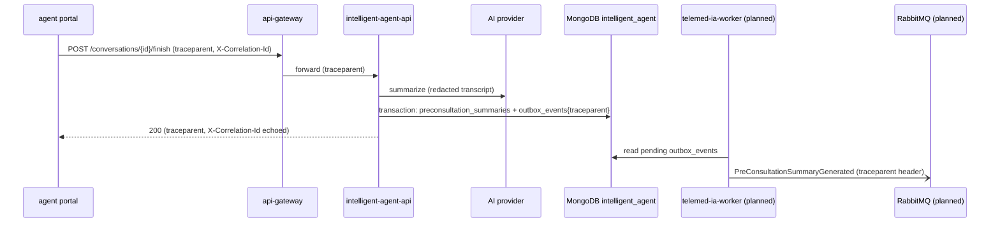

# CP1 — Critical journey and trace map

Journey: a patient completes the AI pre-consultation (HU-06) before the appointment. Paths
follow `agent-service.yaml` (base `/api/v1/agent`).

## Hops

| # | Caller | Receiver | Protocol | Operation | Data written | Status |
|---|---|---|---|---|---|---|
| 1 | agent portal (shell `apiClient`) | telemed-ia-api-gateway | REST | `POST /api/v1/agent/conversations` | — | built |
| 2 | gateway | intelligent-agent-api | REST | same | `conversations`, `messages`, `idempotency_records` | built |
| 3 | intelligent-agent-api | appointment-scheduling-api | REST | appointment check before starting | — | built |
| 4 | portal → gateway → agent | intelligent-agent-api | REST | `POST /conversations/{id}/messages` | `messages` | built |
| 5 | intelligent-agent-api | AI provider (Groq) | HTTPS | next question / summary | — | built |
| 6 | portal → gateway → agent | intelligent-agent-api | REST | `POST /conversations/{id}/finish` | `preconsultation_summaries` + `outbox_events`, one transaction (rs0) | built |
| 7 | telemed-ia-worker | RabbitMQ | AMQP | publish `PreConsultationSummaryGenerated` | — | planned |
| 8 | medical-consultation-api | RabbitMQ | AMQP | consume it | — | planned |

## Sequence

## How the context travels

- **In:** `TraceContextFilter` runs before security. It reads `traceparent`, or starts a new
  trace when the header is missing or malformed. It gives the request its own `span_id` and puts
  `trace_id`, `span_id` and `correlation_id` in the MDC.
- **Out, synchronous:** the call to appointment-scheduling-api carries a child `traceparent` (same
  `trace_id`, new span) and the same `X-Correlation-Id`.
- **Back to the caller:** the response echoes `traceparent` and `X-Correlation-Id`. The error
  envelope's `traceId` is the correlation id.
- **Across the async boundary:** the `PreConsultationSummaryGenerated` outbox document stores
  `traceparent`, which agent-db's validator accepts since `hu-06-010`. The worker must copy it
  into the RabbitMQ message headers so the consumer continues the same trace.
  `TracePropagationTest` checks that the `trace_id` sent on `/finish` is the one stored in the event.

## Differences from the workshop prototype

| Prototype | This service |
|---|---|
| A second `/finish` returns 409 | `/finish` is idempotent: a second call returns the stored summary with 200 |
| Port 8082, metrics on the API port | API on 8086 (behind the gateway), metrics and health on management port 9086 |
| In-memory outbox | MongoDB `outbox_events`, written in the same transaction as the summary |
